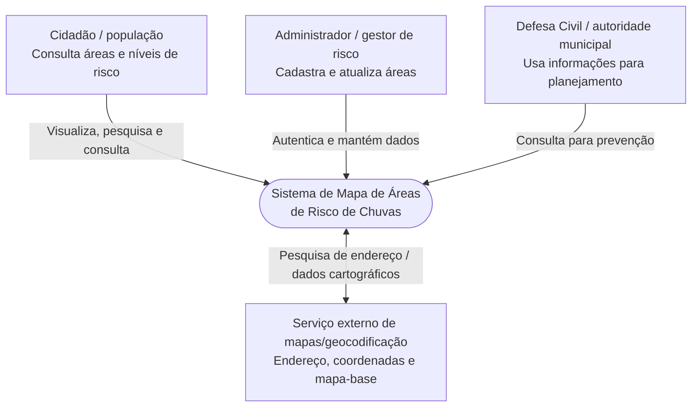
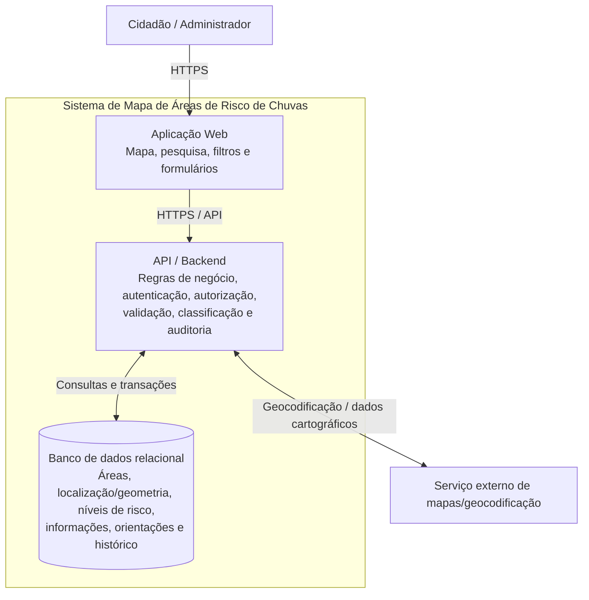

# Arquitetura do Sistema — Mapa de Áreas de Risco de Chuvas

**Projeto Integrador — Aula 07 | Versão 1.0**

## 1. Visão geral

O sistema permitirá que cidadãos visualizem áreas de risco, pesquisem uma localização, consultem a classificação e os perigos associados (como alagamentos e deslizamentos), filtrem áreas por nível de risco e acessem orientações preventivas. Administradores/gestores autorizados poderão cadastrar e atualizar informações, com autenticação e registro das alterações.

A classificação do projeto possui quatro níveis: **baixo, médio, alto e muito alto**. Informações públicas devem ser validadas; alterações administrativas devem ser restritas a perfis autorizados.

## 2. Cinco atributos de qualidade e métricas verificáveis

| Atributo | Importância | Métrica verificável |
|---|---|---|
| Desempenho | O mapa deve responder rapidamente durante períodos de chuva. | Com até **100 usuários simultâneos**, pelo menos **95% das requisições** respondem em **até 2 segundos**. |
| Disponibilidade | A população precisa conseguir acessar o mapa. | Disponibilidade mensal mínima de **99%**, medida por monitoramento automatizado. |
| Usabilidade | O cidadão precisa localizar e entender o risco rapidamente. | Pelo menos **80% dos usuários de teste** localizam uma área e consultam sua classificação em **até 2 minutos**. |
| Segurança e rastreabilidade | Impede alterações indevidas e identifica responsáveis. | **100%** das operações de cadastro/atualização exigem autenticação e autorização e registram responsável, data e hora. |
| Integridade dos dados | Classificações inválidas podem induzir decisões ruins. | **100% das áreas publicadas** possuem localização válida e classificação entre baixo, médio, alto ou muito alto; registros inválidos não são publicados. |

Os quatro primeiros critérios refletem requisitos do documento do Ciclo 1. O critério de integridade explicita uma verificação necessária para aplicar a regra de classificação com segurança.

## 3. Diagrama C4 — Contexto

### Responsabilidades e limites

- **Cidadão:** consulta informações validadas; não altera áreas de risco.
- **Administrador/gestor:** cadastra e atualiza informações após autenticação e autorização.
- **Defesa Civil/autoridade municipal:** utiliza informações para planejamento e prevenção.
- **Serviço externo de mapas:** apoia a pesquisa por endereço e a exibição do mapa. Se estiver indisponível, o sistema deve informar a falha e não inventar uma localização.
- **Sistema:** aplica regras de negócio, consulta e persiste dados e controla permissões.

## 4. Diagrama C4 — Contêineres

### Responsabilidades dos contêineres

1. **Aplicação Web:** apresenta o mapa, pesquisa endereços, filtra por nível e mostra informações e orientações.
2. **API/Backend:** valida entradas, aplica regras de negócio, verifica permissões, coordena consultas externas e registra alterações administrativas.
3. **Banco de dados relacional:** mantém áreas, localização/geometria, classificação, riscos, orientações e auditoria. Recomenda-se suporte espacial, como PostgreSQL com PostGIS, se confirmado pela equipe.
4. **Serviço externo de mapas/geocodificação:** converte endereços em coordenadas e fornece dados cartográficos conforme o provedor escolhido.

## 5. Estilo arquitetural escolhido

### Monólito modular em camadas, com API

Recomenda-se começar com um **monólito modular em camadas**: backend implantado como uma unidade, organizado em módulos de API/apresentação, aplicação/regras de negócio e persistência. A aplicação Web consome a API; o backend acessa o banco.

**Justificativa pelos atributos de qualidade:**

- **Simplicidade e manutenção:** adequado ao escopo acadêmico; centraliza as regras de classificação e autorização.
- **Integridade e segurança:** validação, autorização e auditoria são aplicadas de forma consistente antes de persistir alterações.
- **Desempenho:** reduz a complexidade de comunicação entre serviços internos; o objetivo de 95% das requisições em até 2 segundos será verificado por testes.
- **Disponibilidade:** menos componentes distribuídos para operar; 99% de disponibilidade ainda exige monitoramento, backups e recuperação.
- **Evolução:** módulos bem definidos permitem separar componentes futuramente, caso métricas reais justifiquem isso.

Esta é uma decisão proposta para orientar a implementação, não uma afirmação de que a solução já esteja implementada.

## 6. Riscos e medidas

| Risco | Medida proposta |
|---|---|
| Serviço de mapas lento/indisponível | Definir timeout, tratar erro e informar que a pesquisa não pôde ser concluída. |
| Alteração por usuário não autorizado | Validar autenticação e autorização no backend, não apenas na interface. |
| Classificação ausente ou inválida | Validar no backend e impedir publicação sem dados obrigatórios. |
| Falta de rastreabilidade | Registrar responsável, data/hora e operação em histórico de auditoria. |
| Lentidão com muitos acessos | Executar teste de carga e otimizar consultas/índices conforme resultados. |

## 7. Relação com os requisitos

- **RF-01:** visualizar o mapa.
- **RF-02:** pesquisar área por endereço/localização.
- **RF-03 e RD-01:** exibir níveis baixo, médio, alto e muito alto.
- **RF-04:** cadastrar e atualizar áreas.
- **RF-05:** consultar riscos como alagamentos e deslizamentos.
- **RF-06:** filtrar áreas por nível.
- **RF-07:** apresentar orientações durante chuvas fortes.
- **RF-08 e RNF-04:** restringir alterações e registrar auditoria.
- **RNF-01:** 95% das requisições em até 2 segundos com até 100 usuários simultâneos.
- **RNF-02:** disponibilidade mínima de 99% ao mês.
- **RNF-03:** 80% dos usuários localizam uma área em até 2 minutos.

**Documento-base:** *Especificação de Requisitos — Mapa de Áreas de Risco de Chuvas, Projeto Integrador — Ciclo 1, versão 1.0 (23/09/2026).* Tecnologias específicas devem ser confirmadas pela equipe.
